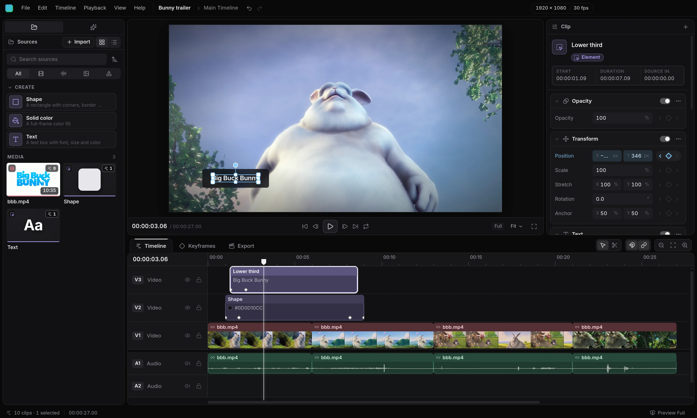

# Cascade

Cascade is a video editor powered by web technology and the DOM. It includes an MCP server and it's also ACP compatible, so you can use agents like Claude Code and Codex directly in the interface, or in other interfaces like their desktop apps or T3 Code.



There's an official website at https://cascade.mileniumhq.com!

It's a young project built with agents in mind. Contributing and PRs don't have strict rules right now, but be respectful and use your common sense. :>

It's TypeScript, and the UI is written in SolidJS and CSS. There is a plugin system, but it doesn't have a site for docs yet. You can ask your agent for information on how it works, and I'll likely publish docs using the GitHub wiki feature.

Development is simple. Use your Node.js runtime (I recommend Bun). MIT licensed, open source.

```zsh
git clone https://github.com/MileniumHQ/Cascade # Clone the repo
cd Cascade                                      # Navigate into the repo
bun run setup:whisper                           # recommended but optional: transcripts and captions
bun install                                     # Install packages
bun run dev                                     # Run the code

bun run test       # Run tests
bun run typecheck  # Ensure your code isn't terrible and evil
bun run dist:linux # Build an AppImage
```

The program currently only targets Linux x64, with more to come. PRs are very welcome, I'm excited to see where this project goes.

---

&copy; 2026 Milenium
